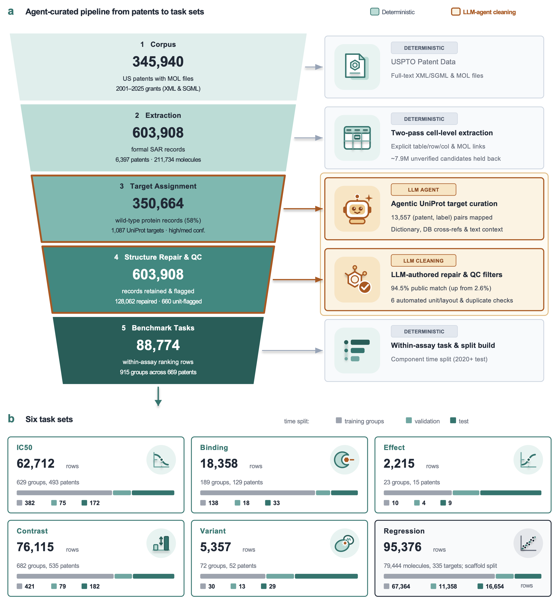

# PatBench

Code and evaluation toolkit for **“PatBench: an agent-curated patent bioactivity dataset for within-assay affinity model benchmarking”**.

PatBench converts structure–activity tables from US pharmaceutical patents (2001–2025) into within-assay molecular ranking benchmarks. Each evaluation group comprises compounds measured in a single patent under one assay label, endpoint and assigned UniProt target, reflecting analogue prioritisation during lead optimisation. Deterministic parsers extract formal records with cell-level provenance from USPTO archives, while language-model agents automate UniProt target curation and author deterministic structure-repair code, complemented by rule-based quality checks and manual verification of test-set targets and reversed-nitrile drawings.

This repository contains **code only**. The released dataset is deposited on figshare under CC BY 4.0 (see [Dataset](#dataset)).



*Figure 1. Overview of the PatBench agent-curated pipeline (deterministic extraction, LLM-agent target curation and structure cleaning, and within-assay task construction) and the six benchmark task sets.*

## Dataset summary

| Item | Value |
|---|---|
| Source corpus | 345,940 US patent MOL archives (2001–2025); 6,397 patents contribute formal records |
| Formal records | 603,908 records across 14 endpoints, 13,122 groups and 211,734 parent molecules |
| Structure repair | 128,062 records repaired from MOL alias lines and reversed nitriles (94.5% public match, up from 2.6%) |
| Target mapping | 11,761 of 13,557 (patent, label) pairs mapped to 1,087 UniProt entries; 350,664 high/medium-confidence wild-type records |
| Novelty | 46.4% of 200,101 affinity-record molecules outside substituent tables are absent from BindingDB (release 2026-09) and ChEMBL 37 |
| Ranking tasks | 5 within-assay tasks (`rank_ic50`, `rank_ki_kd`, `rank_ec50`, `rank_highcontrast`, `rank_complex_mutant`): 915 groups, 88,774 unique rows |
| Regression task | `regression_affinity`: 95,376 pooled rows across 79,444 molecules and 335 targets |
| Splits | Component-level time split (primary, 2020+ test grants), grant-year, random and scaffold splits; no patent or family crosses splits |
| Manual checks | All 205 IC50 and Binding test-group targets audited by domain experts; 583 reversed-nitrile drawings visually inspected |
| Dataset deposit | <https://doi.org/10.6084/m9.figshare.34925475> (CC BY 4.0) |

## Installation

Requires Python 3.9 or newer.

```bash
git clone https://github.com/evonexor/PatBench.git
cd PatBench
pip install -e ".[dev]"
```

The CLI, evaluation toolkit and test suite require only `numpy`, `pandas`, `pyarrow` and `scipy`. Upstream pipeline stages use optional extras:

| Extra | Purpose | Install |
|---|---|---|
| `chem` | Extraction, standardisation, build, protocols and baselines (RDKit) | `pip install -e ".[chem]"` |
| `baselines` | ECFP4 + random-forest baselines (`scikit-learn`, RDKit) | `pip install -e ".[baselines]"` |
| `structures` | Receptor structure retrieval and verification (`gemmi`) | `pip install -e ".[structures]"` |

## Quick start

Run the self-contained demo and repository checks with no data download required:

```bash
python examples/quickstart_eval.py   # synthetic within-assay benchmark demo
patbench verify-code                 # verify pipeline scripts against recorded SHA-256 hashes
pytest                               # run unit test suite
```

## Evaluating your model

Predictions must be supplied as a `.parquet` or `.csv` file with columns `group_id`, `InChIKey` and `score` (higher indicating greater predicted potency; add `repeat` for few-shot evaluations).

### 1. Unpack and verify the figshare release

Download PatBench v1.0 from <https://doi.org/10.6084/m9.figshare.34925475> into `data/` (or any local folder), then unpack and verify all split invariants:

```bash
patbench unpack data --out /tmp/patbench_data
patbench verify-release /tmp/patbench_data
```

### 2. Score predictions (CLI)

`patbench evaluate` invokes the official patent-cluster bootstrap evaluator (`pipeline/10_evaluation/evaluate_patent_bootstrap.py`):

```bash
patbench evaluate /tmp/patbench_data/tasks/rank_ic50.parquet my_predictions.csv \
    --reference /tmp/patbench_data/baselines/rank_ic50_ecfp_rf.parquet \
    --json-out report.json
```

Useful flags include `--tier novel`, `--collapse-stereo`, `--cliffs <protocols/rank_ic50_cliffs.parquet>` and `--fewshot <protocols/rank_ic50_split_time_k5.parquet>`.

### 3. Score predictions (Python API)

```python
from patbench import evaluate_predictions

report = evaluate_predictions(
    "/tmp/patbench_data/tasks/rank_ic50.parquet",
    "my_predictions.csv",
    reference_path="/tmp/patbench_data/baselines/rank_ic50_ecfp_rf.parquet",
)
print(report["summary"]["spearman_median"])
```

You can also run the quickstart script directly against an unpacked release:

```bash
python examples/quickstart_eval.py --release /tmp/patbench_data
```

## Reproducing the pipeline

To rebuild a release from an upstream workspace (`PATBENCH_WORKSPACE`):

```bash
patbench stages                                      # list all processing stages
patbench steps                                       # list runnable steps
export PATBENCH_WORKSPACE=/path/to/workspace
patbench check-workspace                             # check required input tables
patbench plan --out /path/to/release                 # inspect the build chain
patbench release --out /path/to/release --reuse-work /path/to/prior/work
patbench verify-release /path/to/release             # run all 62 release integrity checks
```

## Repository structure

| Path | Description |
|---|---|
| `src/patbench/` | Installable Python package, high-level evaluation API and `patbench` CLI |
| `pipeline/` | Hash-verified processing scripts organised by stage (`01_public_data` through `12_verify`; see [pipeline/README.md](pipeline/README.md)) |
| `examples/` | Runnable evaluation quickstart ([examples/quickstart_eval.py](examples/quickstart_eval.py)) |
| `configs/` | Build parameters of the reference release (`release_v1.0.json`) |
| `provenance/` | `CODE_MANIFEST.tsv`, `STAGE_HASHES.json` and `NOT_INCLUDED.tsv` |
| `tests/` | Automated unit tests (code integrity, CLI, evaluator metrics, release checks) |
| `data/` | Local mount directory ignored by git ([data/README.md](data/README.md)) |
| `assets/` | Overview figure embedded in this README |

## Code provenance

- The upstream extraction, recovery and structure-catalogue stages (`02_extract`, `03_recovery`, `04_catalog`) are byte-identical to the executed code; `patbench verify-code` recomputes their SHA-256 hashes against `provenance/STAGE_HASHES.json`.
- Remaining pipeline scripts were modified only to replace machine-specific workspace prefixes with `_ws` (read from `PATBENCH_WORKSPACE`), recorded per file in `provenance/CODE_MANIFEST.tsv`.
- Exact language-model prompts/snapshots and external model-scoring harnesses are not included and are catalogued in `provenance/NOT_INCLUDED.tsv`.

## Dataset

No dataset files are tracked in git. The released dataset (**PatBench v1.0**) is deposited on figshare:

- **DOI:** <https://doi.org/10.6084/m9.figshare.34925475>
- **Licence:** Creative Commons Attribution 4.0 International (CC BY 4.0)
- **Deposit contents:** 10 files (~124.5 MB): `sar_all.parquet`, `groups.parquet`, `targets.parquet`, `target_sequences.parquet`, `release_manifest.json`, `tasks.zip`, `protocols.zip`, `eval_all.zip`, `baselines.zip` and `README.md`
- **Integrity check:** run `patbench verify-release <unpacked_dir>` to verify all split invariants and manifest counts

## Citation

If you use PatBench or this repository, please cite:

```bibtex
@misc{wu2026patbench,
  title  = {PatBench: an agent-curated patent bioactivity dataset for within-assay affinity model benchmarking},
  author = {Wu, Wenfan and Xiao, Xianglu and Gong, Hao and Li, Ang and Deng, Shenglong and Dai, Boyuan and Yang, Guang and Ge, Hu and Chen, Hongming},
  year   = {2026},
  doi    = {10.6084/m9.figshare.34925475},
  url    = {https://doi.org/10.6084/m9.figshare.34925475}
}
```

## License

- **Code:** [MIT License](LICENSE).
- **Dataset:** Creative Commons Attribution 4.0 International (CC BY 4.0), deposited on figshare.
- **External resources:** BindingDB, ChEMBL, UniProt, RCSB PDB, AlphaFold DB and USPTO patent grants remain governed by their respective terms and are not redistributed in this repository.
